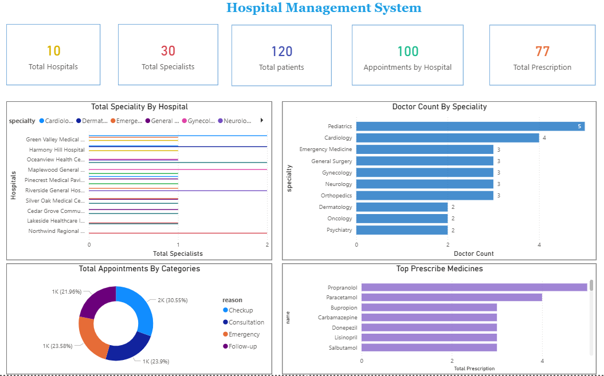
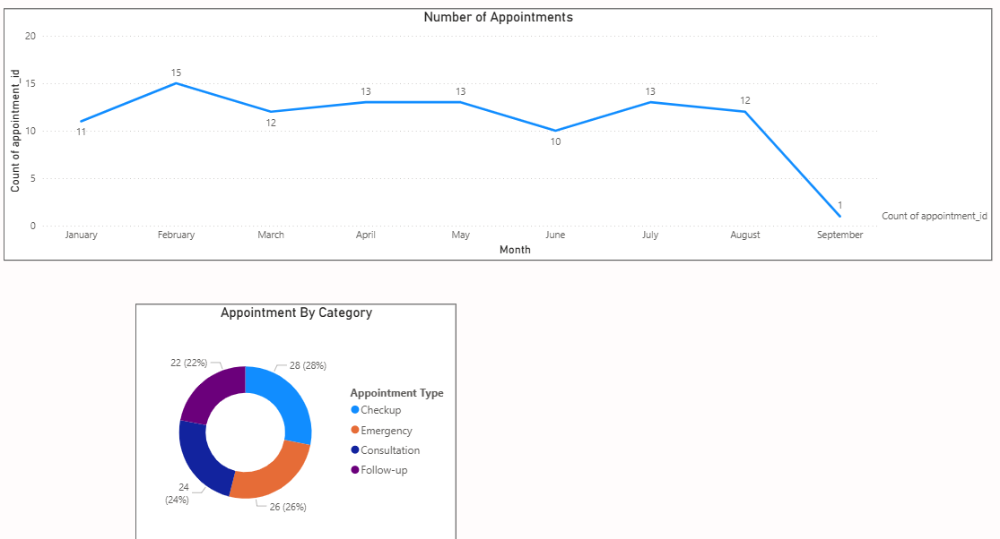
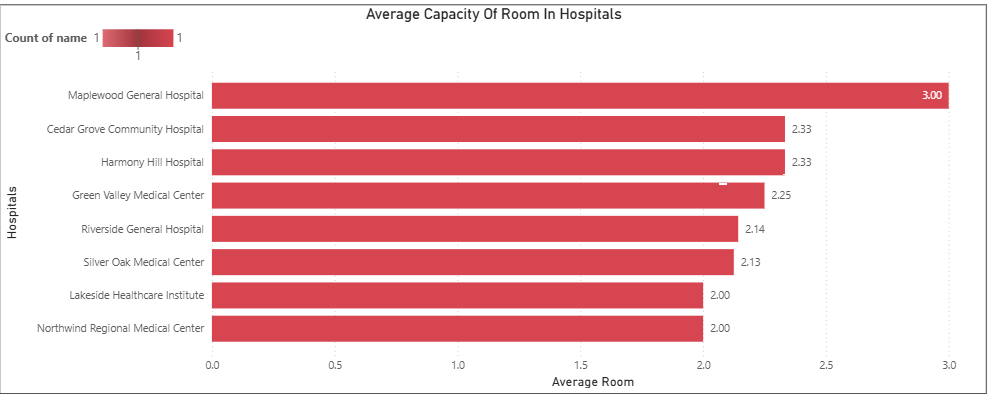

# 🏥 Hospital Management System - Data Analysis (MySQL + Power BI)

## 📌 Project Overview
This project features a comprehensive relational database design and data analysis pipeline for a Hospital Management System. I designed the database schema in **MySQL**, wrote complex SQL queries to extract insights, and connected the data to **Power BI** to build an interactive dashboard for hospital administration.

## 🗄️ Database Schema & SQL Highlights
The database consists of 8 interconnected tables: `hospitals`, `doctors`, `patients`, `appointments`, `departments`, `medications`, `prescriptions`, and `rooms`.

**Advanced SQL Techniques Used:**
*   **Common Table Expressions (CTEs):** Used for calculating the second-largest room capacity per hospital.
*   **Window Functions:** Used `DENSE_RANK()` to find the 3rd most frequently prescribed medication.
*   **Subqueries:** Identified patients who have never received a prescription.
*   **Conditional Logic:** Used `CASE WHEN` to categorize patients into Pediatric, Adult, and Geriatric age groups.
*   **Complex Joins:** Joined 4+ tables to track patients who visited multiple hospitals.

## 📊 Dashboard Preview
*Built using Power BI Desktop, connected directly to the MySQL database.*

### 1. Executive Overview & KPIs

*Tracks Total Hospitals (10), Doctors (30), Patients (120), Appointments (100), and Prescriptions (77).*

### 2. Appointment Trends & Categories

*Analyzes monthly appointment volume and the distribution of appointment types (Checkups, Emergency, Consultation, Follow-up).*

### 3. Room Capacity & Facility Utilization

*Shows the average room capacity across different hospitals to identify high-density inpatient centers.*

## 🔍 Key Findings & Insights

### 1. Core Performance Indicators (KPIs)
*   **Patient Reach:** The network manages a database of **120 patients**.
*   **Medical Staffing:** **30 doctors** are distributed across 10 facilities.
*   **Activity Ratio:** The system processed **100 appointments** and **77 prescriptions**, showing a high ratio of visits resulting in medication.

### 2. Facility Utilization & Emergency Analysis
*   **Top Volume Facility:** **Silver Oak Medical Center** is the busiest hub, handling the highest number of appointments.
*   **Emergency Leader:** **Northwind Regional Medical Centre** manages the highest volume of emergency cases (6 cases).
*   **Actionable Insight:** Resource allocation should be prioritized for Silver Oak Medical Center, and Northwind Regional should be prioritized for emergency equipment upgrades and increased room capacity.

### 3. Capacity & Staffing
*   **High-Density Center:** **Maplewood General Hospital** operates with the highest average room capacity (3.0 beds/room), making it the primary center for large-scale inpatient care.
*   **Specialty Demand:** **Pediatrics** (5 doctors) and **Cardiology** (4 doctors) have the highest doctor counts, reflecting a high demand for these specialties.

### 4. Patient Trends & Service Composition
*   **Temporal Patterns:** Appointment volumes show consistent peaks on Mondays, suggesting higher demand at the start of the week.
*   **Service Composition:** The majority of visits are "Checkups" and "Follow-ups," showing a strong reliance on routine health maintenance. "Emergency" visits represent 26% of the total.

## 💡 Business Recommendations
Based on the data, the following actions are recommended for hospital administration:
1.  **Optimize Staffing Schedules:** Use the weekly appointment trend data to ensure more administrative and clinical support is available on Mondays.
2.  **Inventory Management:** Ensure high stock levels of the top-prescribed medicines: *Propranolol, Paracetamol, Bupropion, and Carbamazepine*.
3.  **Capacity Expansion:** Increase room capacity at Northwind Regional Medical Centre to handle emergency patient transfers to inpatient care.

## 🛠️ Tools & Technologies
*   **Database:** MySQL (MySQL Workbench)
*   **Visualization:** Microsoft Power BI Desktop
*   **Languages:** SQL, DAX
